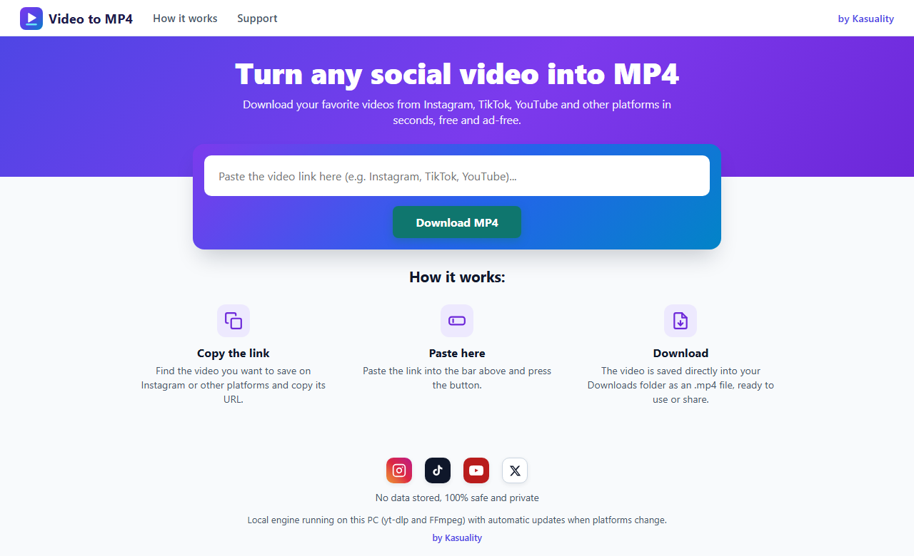

# Video to MP4 — Local, Private, Ad-Free Social Video Converter

A lightweight, 100% local desktop web app to save public social videos as standard `.mp4` files directly on your computer — powered by **yt-dlp** and **FFmpeg**.

No ads, no pop-ups, no third-party servers, and no resolution caps.



---

## Why Video to MP4 is Better Than Online Downloader Websites

| Feature | Ad-Filled Online Websites | Video to MP4 (Local) |
| :--- | :--- | :--- |
| **Privacy** | Logs your URLs and tracks cookies | **100% local** on `127.0.0.1` — zero data leaves your PC |
| **Ads and Pop-ups** | Invasive banners, redirects, fake buttons | **Zero ads**, zero pop-ups, clean single-screen UI |
| **Quality** | Often capped at 720p or broken audio | **Full native quality** merged cleanly to `.mp4` via FFmpeg |
| **Maintenance** | Frequently broken when platforms change | **Automatic daily `yt-dlp` self-update** built into `server.py` |
| **Languages** | Usually English-only | **Auto-localized** in 5 languages (`EN`, `IT`, `FR`, `ES`, `DE`) |
| **Accessibility** | Poor contrast and cluttered layouts | **WCAG 2.1 AA verified** contrast and keyboard focus rings |

---

## Quick Start (Windows / macOS / Linux)

### 1. Prerequisites
- **Python 3.10+**
- **FFmpeg** installed and available on your system `PATH`
- Python packages:
  ```bash
  pip install flask yt-dlp
  ```

### 2. Run the App
- **Windows:** double-click `avvia.bat` (starts silently in the background and opens `http://127.0.0.1:5000` in your default browser).
- **macOS / Linux / Terminal:**
  ```bash
  python server.py
  ```

---

## Legal and Responsible Use Notice

> **Important:** This tool is provided strictly for **personal use, backing up your own content, and downloading authorized or copyright-free material**.
>
> You are solely responsible for ensuring that you have the necessary rights or permission from the content owner before downloading any media, and for complying with the Terms of Service of the respective platforms and applicable copyright laws. Do not use this software to infringe copyrights or bypass DRM protections.

---

## Credits

Built with care **by [Kasuality](https://www.kasuality.com/en/)** — perceptual color engineering (`OKLCH`, `APCA`, `K-UDA`) and developer tools.
